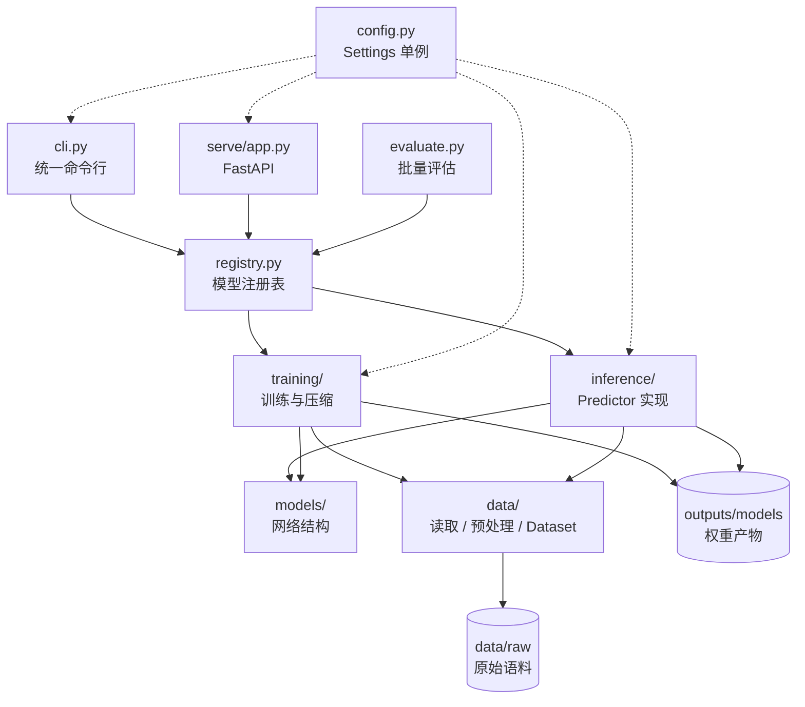

# 架构说明

## 1. 设计目标

原始项目是 8 个并列的教学脚本目录（`_01_data` … `_08_bert_pruning`），每个目录各自持有一份
`Config`、`dataloader`、模型定义和 Web 部署脚本。它的优点是"按课时顺序阅读很直观"，
但随着模型变多，出现了三个问题：

1. **配置漂移**：8 份 `Config` 内容不一致，且把 `F:\...` 绝对路径写死在代码里；
2. **代码复制**：`dataloader / model / eval` 各复制 4 份，Web 部署复制 8 份（约 5000 行几乎相同）；
3. **无法统一调用**：想对比 8 个模型，需要手动改 8 次 import 和端口。

重构后的目标是：**一个包、一份配置、一套接口、一条命令**。

## 2. 分层结构



## 3. 目录职责

| 路径 | 职责 |
| --- | --- |
| `src/news_clf/config.py` | 唯一的配置入口：路径全部由项目根推导，超参可用环境变量覆盖 |
| `src/news_clf/labels.py` | 标签唯一来源（`data/raw/class.txt`）+ 中文释义 + LLM 输出归一化 |
| `src/news_clf/data/` | 数据读取（容错解析）、分词/分字、FastText 格式转换、Dataset 与 DataLoader |
| `src/news_clf/models/` | 纯网络结构：`BertClassifier`、`BiLSTMClassifier`、`LLMClassifier` |
| `src/news_clf/training/` | 训练流程：随机森林、FastText、BERT 微调、知识蒸馏、量化/剪枝 |
| `src/news_clf/inference/` | 推理实现：所有模型实现同一个 `Predictor` 协议 |
| `src/news_clf/registry.py` | 模型注册表：展示名、产物路径、构造函数、可用性检查 |
| `src/news_clf/evaluate.py` | 任意模型 × 任意划分的统一评估 |
| `src/news_clf/serve/` | FastAPI 应用与单页前端 |
| `scripts/` | 一次性运维脚本（下载预训练权重） |
| `outputs/` | 模型、日志、评估报告（权重不入库） |

## 4. 三个核心抽象

### Settings（配置）

```python
settings = get_settings()          # 进程内单例
settings.train_file                # 路径全部由 root 推导
settings.bert_path                 # 模型产物路径
settings.device                    # cuda / mps / cpu 自动探测
settings.labels                    # 读取 class.txt
```

### Predictor（推理协议）

```python
class Predictor(ABC):
    def _predict(self, text) -> dict[str, float]: ...   # 只需实现这一层
    def predict(self, text) -> Prediction: ...           # 公共逻辑：计时 / 归一化 / 取 argmax
```

因此 Web 服务、CLI、评估脚本都不需要关心底层是 sklearn、FastText 还是 BERT。

### ModelSpec（注册表）

```python
MODEL_SPECS["bert"] = ModelSpec(
    display_name="BERT 微调",
    artifacts=lambda s: (s.bert_path,),     # 用于判断"是否已训练"
    factory=lambda s: BertPredictor(s),     # 延迟导入，避免无谓依赖
)
```

新增一个模型只需要三步：写 `Predictor` 子类 → 在 `MODEL_SPECS` 注册 → 在 `training/` 加训练流程。
Web 页面和 CLI 会自动出现该模型，无需改任何调用方。

## 5. 数据流

```
data/raw/{train,dev,test}.txt        text<TAB>label_id
        │
        ├── data/processed/rf/*.tsv          分词后的 TSV（随机森林）
        └── data/processed/fasttext/*.txt    __label__xxx 格式
                │
                ▼
        training/{rf,fasttext,bert}.py
                │
                ▼
        outputs/models/{tfidf,random_forest,fasttext_word,bert,bilstm_student,
                        bert_quantized,bert_pruned}
                │
                ▼
        registry.create_predictor(key)  →  serve / cli / evaluate
```

## 6. 与原项目的对照

| 原路径 | 新位置 |
| --- | --- |
| `_01_data/_01_config.py` … `_05_llm/_01_config.py`（8 份） | `src/news_clf/config.py`（1 份） |
| `_01_data/_03_了解分析数据.py` | `src/news_clf/data/eda.py` + `news-clf eda` |
| `_02_rf/_02_数据分词并存储.py` | `src/news_clf/data/preprocess.py` |
| `_04_bert/_02_dataloader_utils.py`（复制 4 份） | `src/news_clf/data/dataset.py`（1 份） |
| `_04_bert/_03_bert_classifier_model.py`（复制 4 份） | `src/news_clf/models/bert.py` |
| `_0x_*/_0x_*_predict_fun.py`（7 份） | `src/news_clf/inference/*.py` + `Predictor` |
| `_0x_*/_0x_基于flask的web部署.py`（8 份约 5000 行） | `src/news_clf/serve/`（1 套） |
| `_06/_07/_08` 的量化、蒸馏、剪枝脚本 | `src/news_clf/training/compression.py`、`distillation.py` |
